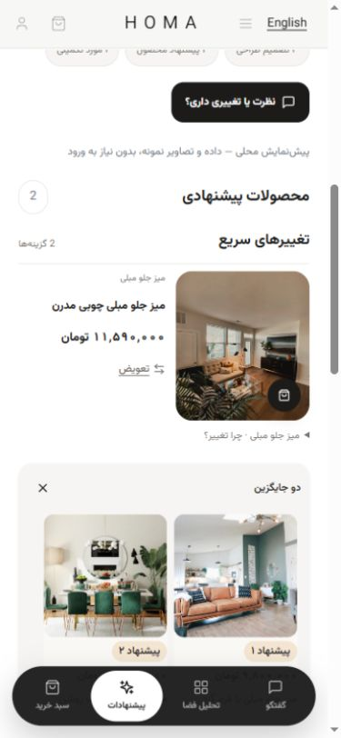
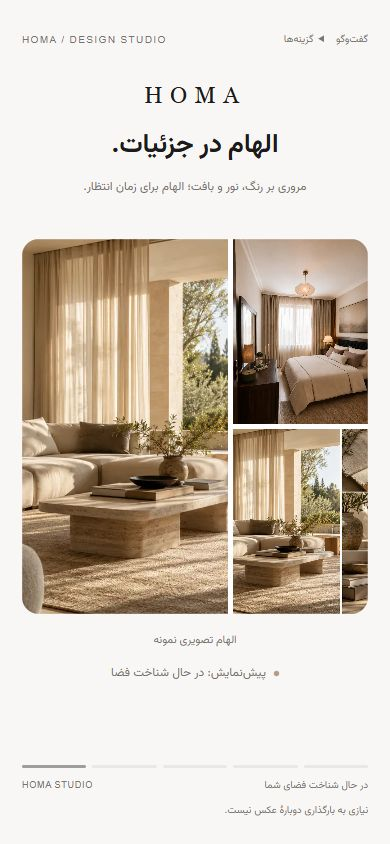
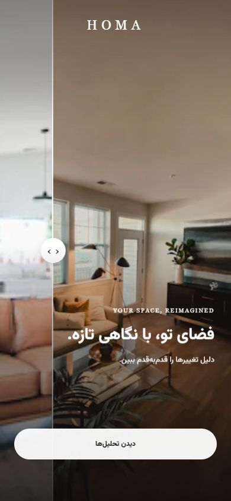
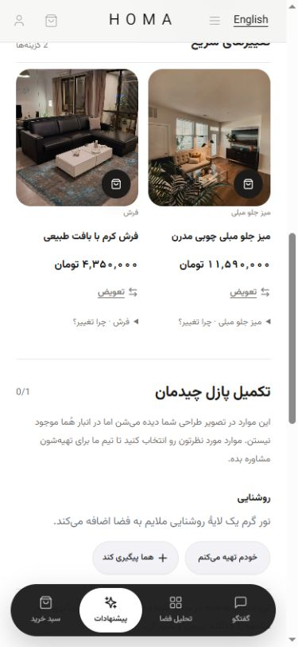
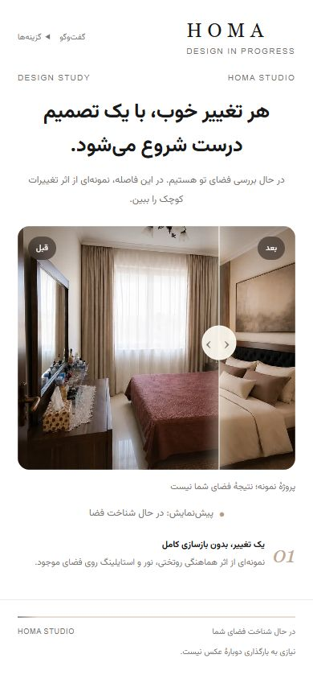
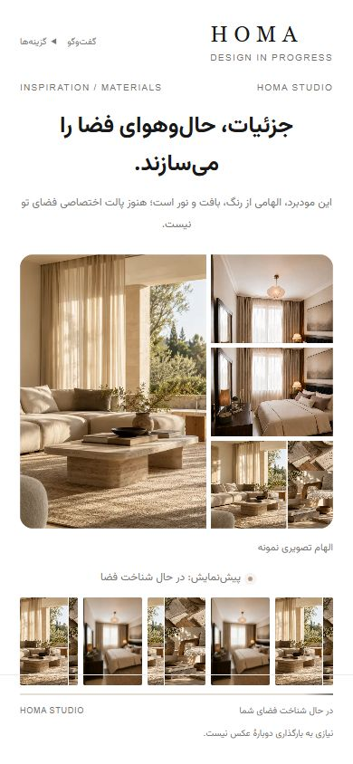
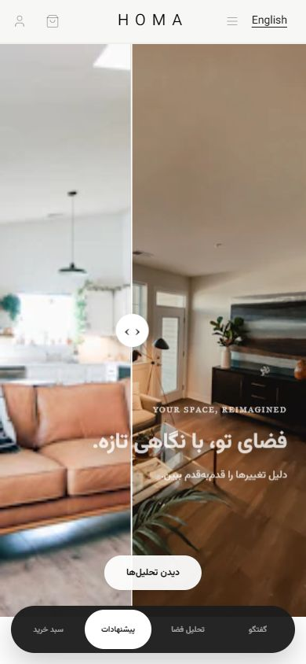
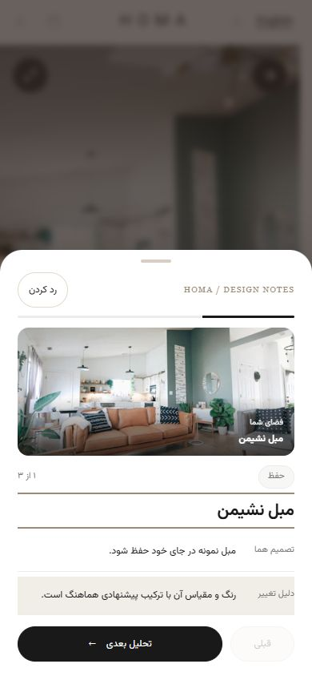
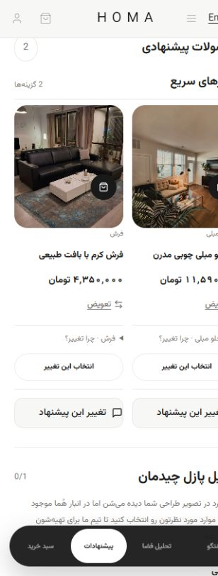

# Homa V9 integration

Feature branch: `codex/homa-v9-polished`. Target: `dev`. Review before merging; no production deployment is part of this change.

Visual authority: `HOMA_STUDIO_VISUAL_CONTRACT.md`. The row-layout follow-up does not introduce a new visual style: added product frames and filled card surfaces were removed, while rows and inline alternatives remain. The V9 reference continues to govern the surrounding graphics.

## Product-row follow-up

The latest product presentation is one horizontal row per product, keeping the previous photographic size and aspect ratio, typography, prices and shopping controls. Swap expands a two-column alternatives panel inside the same card, with bounded internal scrolling and the existing close/promote actions. It does not open a new page or issue a model request. Checked at 320/390/430 pixels, including quantity controls at 320; no horizontal page overflow. The 16 focused product/result interaction tests pass; production build passes.

## Visual review revision

A second comparison against the approved HTML found that the first integration retained too much of the previous shell: duplicated loading labels, a smaller image, redundant moodboard thumbnails, a reveal clipped by the result layout, and too many permanently expanded product actions.

The revised loading composition uses the reference's top utility line, centered wordmark, calmer title, 45svh photo, two-part moodboard and bottom stage indicators. Indicators derive from the actual stage key, not elapsed time. The original photo still requires analysis readiness.

The reveal now renders through a body portal so route transitions cannot clip its viewport. The original Header returns after the reveal. Existing completion timing, reduced-motion path, analysis sequence and navigation remain unchanged. The result introduction includes counts derived from actual findings/recommendations/completion items and the existing conversation action.

Product cards keep photography, title, price and alternatives prominent. Design reasoning, independent acceptance and product feedback live in one disclosure on the same card. Merchant product details and all shopping handlers remain unchanged. Floating navigation icons and analysis title focus styling were corrected.

Updated screenshots are in `v9-screenshots/revision/`. These labelled previews verify component behavior and presentation, not live model quality.

## Implementation

The approved HTML is a visual reference, not an application dependency. Scoped `v9-polished.css` applies its light photographic presentation and Vazirmatn typography to the existing Studio components. No dependencies, backend contracts, recommendation ranking, pricing, authentication or checkout logic were changed.

- `HomaLoadingExperience` and `ProgressScreen`: editorial title, inspiration comparison, moodboard and actual status presentation.
- `ResultPage`, `IntegratedResultJourney`: result reveal, CSS transform/opacity animation, existing once-per-result journey and analysis sheets. No generated image means the original-image/analysis-only experience remains available.
- `TierSection`, `RecommendationCard`: image-first product rows, existing intervention groups, inline alternatives, quantities and pricing. Design acceptance is a separate action from adding to the basket; reasons remain available through disclosure.
- `SpatialDiagnosis`, `CompletionChecklist`, `UnifiedConsultationCTA`, `InlineFeedbackWidget`: consistent hierarchy and restrained controls, retaining their existing handlers.
- Development-only previews: enabled under the existing loopback preview mode; added an analysis-only fixture. Production route gating remains intact.

## Backend-to-UI mapping retained

| Actual input | UI behavior |
| --- | --- |
| Analysis not ready | Inspirational comparison followed by moodboard; never presented as the user's result |
| Analysis ready and original photo available | User photo and real analysis findings can be revealed |
| Plan available | Actual design decisions, paired with their observations |
| Search / render / finalize stage | Existing live stage labels; image preparation state is not a fabricated completion percentage |
| Ready with generated image | Before/After reveal ends on After, then sequential validated findings, then recommendations |
| Ready without generated image | Original photo and analysis; no fake After image |
| Failure / retry | Existing error, recovery and retry callbacks; ready analysis is retained |
| Basket / alternatives / feedback | Existing selection handlers and feedback API; no simulated production commerce |

Presentation timing only controls introductory animation. It does not advance backend job readiness or launch model requests.

## Validation

- Full Vitest suite: 306 tests across 66 files passed.
- ESLint zero-warning gate, TypeScript check and production compilation passed. Build retains the existing large-chunk warning; sitemap generation retained the existing sitemap when the configured backend was unreachable.
- Focused interaction tests cover design acceptance independently of basket updates and feedback success/failure persistence.
- Browser verification used the real production components with explicitly labelled local fixture data, not paid model runs: reveal, all three analysis steps, skip, recommendations, independent design acceptance, add-to-basket, quantity increment, alternative selection, error and retry.
- Mobile viewport checks at 320, 390 and 430 pixels: no document horizontal overflow. Results are in `v9-screenshots/viewport-checks.json`.
- Screenshots: loading, moodboard, reveal, analysis, recommendations at all three widths, selected-product alternatives and error. Compared with the supplied V9 reference.
- Existing loading-state and reduced-motion tests remain in the suite.

## Boundaries and limitations

The browser test uses fixtures and does not establish live model/provider availability, a real paid checkout, or live feedback delivery. Feedback transport is verified with API mocks. Prototype-only fake progress, fake recommendations, fake checkout and unsupported AI redesign actions were not adopted. Existing sourcing/consultation intentions retain their current behavior; choosing an intention does not itself submit a consultation request.

The current checkout inherited 96 commits ahead of `dev`. Commit `8686215` additionally records the deployed Studio baseline that was previously uncommitted. Review that baseline/history separately from the V9 presentation commit; this PR is not represented as a clean patch onto an otherwise current `dev`.

## Screenshots

