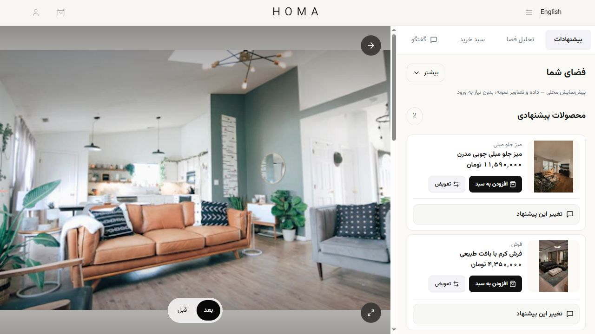
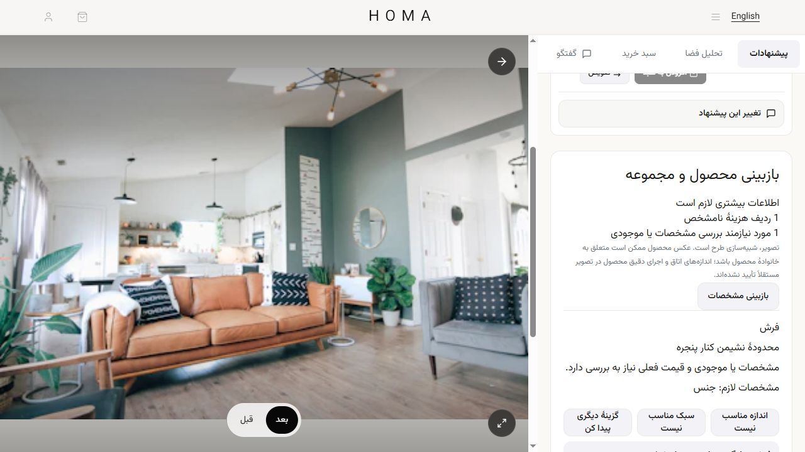

# Studio V2 execution contract

The integration is isolated on `codex/studio-v2-integration`, based on
`codex/isolated-development` at `3a0f23652bd7ddf64c00e794bd13b00e38ca0fa6`.
It requires the matching HomaBackend integration on top of retrieval V2 (PR #4).
No deployment, production data changes or catalogue migrations were performed.

## Release and rollback

`VITE_STUDIO_SEARCH_V2=true` makes newly created sessions explicitly request
`studio-design-v2` and `studio-search-v2`. Unset/false preserves the current
creation behavior. Saved sessions keep the backend's pinned version. Keep the
backend new-session default on search V1; deploy compatible API, text/image workers
and this frontend before enabling a trial. Disable the frontend flag to roll back
new sessions; keep V2 readers/workers available for saved V2 conversations.

## Behavior

- Preserve intent, placement and SKU identities through live requests, retries,
  history and presentation. Two variants of a family remain independent options.
- Show variant labels, dimensions and purchase verification in the original
  Studio cards, product sheet and printed report. Review-only candidates stay in
  a separate review section. Unknown price is not displayed as a free product.
- Main-product changes in V2 use an explicit `select_product` turn. The backend
  reviews the changed set without requesting an image. Working-plan review has
  its own `current` view and retains the appropriate base image.
- Distinguish missing costs, specification/stock verification, invalid explicit
  choices, source checks and typed size/style/alternative feedback. User-authored
  notes are sent unchanged; clicking a control does not invent user text.
- Before adding V2 selections to the basket, call the owner-bound read-only
  `/recommendations/chat/sessions/{id}/purchase-check/` endpoint. Reject unapproved
  selections and changed prices; preserve exact variant and placement/quantity.
  Basket lines aggregate by `(product_unique_link, variant_id)`. Failed quantity
  updates do not open the basket as if finalization succeeded.
- V1 keeps its existing local selection and finalization path. No assumption is
  made that product photos prove the selected size or exact generated-image execution.

## Validation

- Full Vitest: **215 passed / 48 files**.
- TypeScript and ESLint: passed.
- Production compiler/bundler: `npm --ignore-scripts run build` passed. The first
  `npm run build` prebuild sitemap attempt hit the existing backend products URL
  returning 404 and a Windows Node assertion; the actual type-check/Vite/PWA
  build passed without running network-dependent lifecycle scripts.
- Local browser inspection: variant labels/dimensions, disabled purchase of
  unverified merchandise, product detail sheet and separate review candidates.
  Images below use illustrative fixtures, not real merchant facts/model output.
- No authenticated live-server E2E, paid provider calls or real catalogue benchmark.
  Catalogue alignment, source trust/coverage and non-piece order arithmetic remain
  the backend's separately deferred work and prerequisites for broad activation.

Run `npm run dev:studio`, then visit `/studio?preview=v2` for the development-only
UI fixture. Its checkout/review controls cannot place orders or call a model.

| Previous V1 fixture | V2 review fixture |
| --- | --- |
|  |  |
