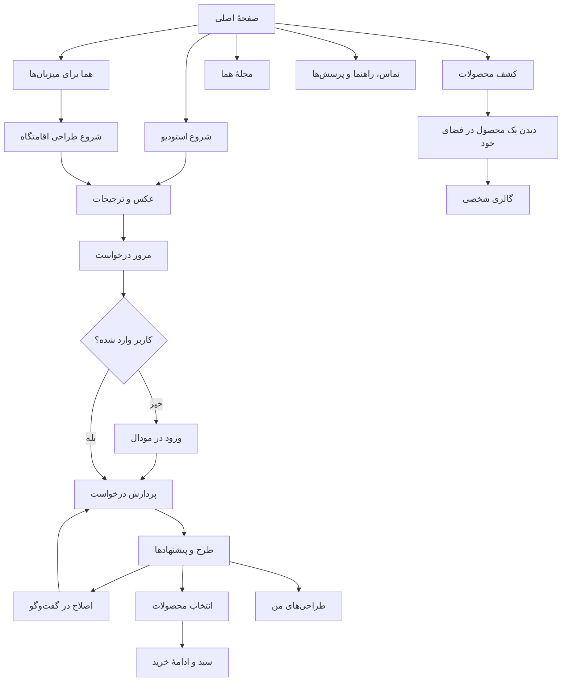
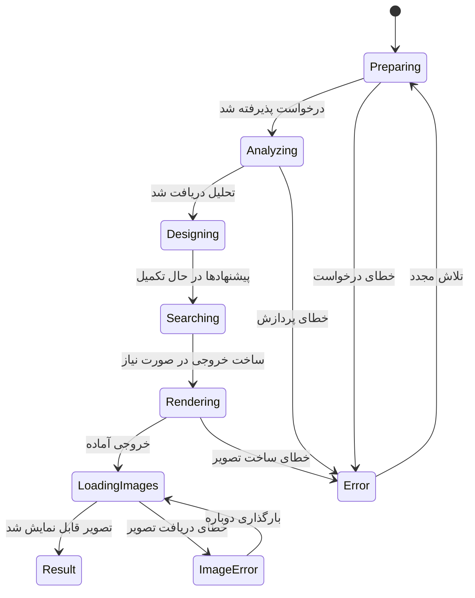
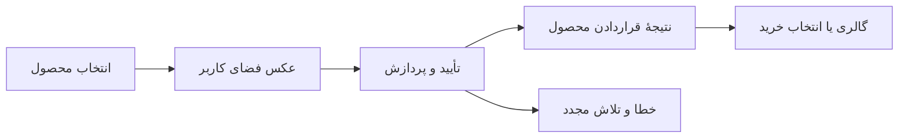

# هما — نقشهٔ سایت و راهنمای طراحی تجربهٔ کاربر

تاریخ تدوین ۲۰ نوامبر ۲۰۲۶، برابر با ۲۹ آبان ۱۴۰۵.

این سند برای دیزاینری تهیه شده که باید ساختار صفحه‌ها، مسیر کاربر و رفتار رابط هما را بشناسد و طراحی استودیو را ادامه دهد. زبان اصلی فارسی و جهت پیش‌فرض راست‌به‌چپ است.

## از اینجا شروع کن

اولویت فعلی، مسیر پس از کلیک «شروع استودیو» تا شروع پردازش است. لندینگ فعلی از نظر مالک محصول مبنای پذیرفته‌شدهٔ طراحی است. هویت، تصاویر و لحن آن مرجع ادامهٔ تجربه‌اند.

کار اصلی دیزاینر، روشن‌کردن این زنجیره است.

**عکس خانه → خواسته‌های کاربر → مرور درخواست → ورود → پردازش واقعی → پیشنهاد طراحی → اصلاح → انتخاب محصول و ارتباط با فروشنده**

هما باید در هر مرحله به کاربر کمک کند تصمیم بعدی را بگیرد. ارزش محصول از دید کاربر، رسیدن به تغییر مناسب خانه، استفاده از وسایل موجود و خرید آگاهانه است.

### مبنای این تحویل

| مبنا | وضعیت و کاربرد |
| --- | --- |
| سایت عمومی | `https://myhoma.ir` برای مشاهدهٔ تجربهٔ منتشرشده |
| مرجع تاریخی تولید | شاخهٔ `codex/production-server-20261110` همراه با `docs/production/README.md` و `source-manifest.json`، ثبت نسخهٔ ۱۰ نوامبر |
| نقشهٔ صفحه‌ها در این سند | استخراج از `src/App.tsx`، `src/seo/routes.ts` و کامپوننت‌های محیط کاری در تاریخ تدوین |
| اصلاحات جدید استودیو | در زمان تدوین محلی هستند. شامل مسیر کلی سه‌بخشی، عبور از انتخاب‌های اختیاری، بازگشت مستقیم از ویرایش به مرور و عکس شخصی در لودینگ |
| این شاخهٔ تحویل | برای مستندات طراحی ساخته شده و به‌تنهایی شامل تمام تغییرات محلی رابط نیست |

شاخهٔ مرجع تولید، یک ثبت تاریخی است. برای تعیین اینکه چه کدی اکنون روی سرور اجرا می‌شود، باید آخرین انتشار و تنظیمات زمان اجرا هم بررسی شوند. شاخهٔ پیش‌فرض و PRهای باز به‌تنهایی وضعیت استقرار را مشخص نمی‌کنند.

## ۱. نقشهٔ کلی سایت

فلش «ادامهٔ خرید» مقصد تجربه را نشان می‌دهد. آماده‌بودن محصول، قیمت و لینک فروشنده باید پیش از اقدام نهایی کنترل شوند. پرداخت اعتبار طراحی و خرید کالا دو عملیات جدا با مبلغ و رسید مستقل‌اند.

## ۲. فهرست مسیرهای عمومی

| URL | نقش صفحه | اقدام یا مقصد اصلی |
| --- | --- | --- |
| `/` | معرفی هما و روایت مسئله تا راه‌حل | ورود به `/studio` |
| `/hosts` | معرفی کاربرد هما برای میزبان اقامتگاه | `/studio/hosts` |
| `/explore` | نمایش عمومی محصولات و دسته‌ها | انتخاب محصول و ورود به تجربهٔ محصول |
| `/shop` | مسیر جایگزین نمایش محصولات در React | تجربهٔ `/explore` |
| `/gallery` | آدرس قدیمی گالری عمومی | هدایت به `/explore` در React |
| `/blog/` | فهرست مقالات مجله | مقاله یا دسته |
| `/blog/:slug` | متن مقاله | مقالهٔ مرتبط یا شروع طراحی |
| `/blog/category/:slug` | مقالات یک دسته | مقاله |
| `/collaboration` | همکاری فروشگاه‌ها و برندها | فرم همکاری و نتیجهٔ ارسال |
| `/contact` | تماس | راه ارتباطی مرتبط |
| `/faq` | پرسش‌های متداول | پاسخ یا شروع استودیو |
| `/support`، `/privacy`، `/terms` | راهنما و اطلاعات حقوقی | بازگشت به مسیر مرتبط |
| `/s/:token` | نمایش عمومی نتیجهٔ به‌اشتراک‌گذاشته‌شده | مشاهده و شروع تجربهٔ شخصی |

صفحات `/ai-interior-design` و `/virtual-product-preview` در نقشهٔ محتوای عمومی SEO ثبت شده‌اند. نحوهٔ سرو و ورود از آن‌ها را همراه با فایل‌های `src/seo/` بررسی کنید. بعضی صفحات اطلاعاتی همچنین خروجی HTML ایستا دارند.

### ناوبری عمومی

هدر لندینگ به روایت طراحی و خرید، توضیح مراحل، مجله و بخش میزبان‌ها لینک می‌دهد. حساب کاربری، سبد و منو از کنترل‌های کاربردی هدر هستند. ورود، یک مودال است و مسیر مستقلی مانند `/login` در `App.tsx` ثبت نشده است.

انکرهای صفحهٔ اصلی مانند `#buying-problem` و `#design-steps` بخش‌هایی از همان صفحه‌اند. در طراحی فایل، آن‌ها را به‌عنوان مقصد اسکرول در نظر بگیرید.

## ۳. مسیرهای استودیو و حساب

| URL | کارکرد موجود | ورود و وضعیت |
| --- | --- | --- |
| `/studio` | نقطهٔ شروع فعلی طراحی | انتخاب‌ها پیش از ورود ممکن است، ارسال درخواست پس از ورود |
| `/studio/hosts` | همان شروع با ترجیحات میزبان | حفظ زمینهٔ اقامتگاه |
| `/studio/start` | مسیر جایگزین شروع | هدایت به `/studio` |
| `/studio/chat/:sessionId` | جلسهٔ طراحی، پردازش، نتیجه و گفت‌وگو | نیازمند ورود |
| `/studio/projects` | فهرست طراحی‌های کاربر | محافظت‌شده با مودال ورود |
| `/studio/project/:projectId` | جزئیات پروژهٔ ذخیره‌شده | محافظت‌شده |
| `/account/gallery` | گالری نتایج شخصی | محافظت‌شده |
| `/account/gallery/:id` | جزئیات یک نتیجه | محافظت‌شده |
| `/basket` | سبد انتخاب‌ها | وضعیت خالی، پر و خطا باید طراحی شوند |
| `/account/orders` | جایگاه سفارش‌ها | فعلاً متن «به‌زودی» |
| `/account/settings` | جایگاه تنظیمات حساب | فعلاً متن «به‌زودی» |

لودینگ، نتیجه، اصلاح و انتخاب محصول در مسیر گفت‌وگوی استودیو می‌توانند حالت‌های مختلف یک جلسه باشند. برای هر حالت می‌توان فریم جدا در فایل طراحی ساخت، درحالی‌که URL جلسه ثابت می‌ماند.

## ۴. مسیر اصلی طراحی — رفتار موجود و اصلاحات محلی

### ورود از لندینگ

با کلیک CTA، کاربر باید بداند عکس چه فضایی لازم است و در انتها چه چیزی دریافت می‌کند. شروع آماده‌سازی درخواست، خودش آغاز تولید تصویر نیست. ورود به حساب هنگام تأیید درخواست انجام می‌شود.

در محیط کاری، آماده‌سازی فعلی شش صفحهٔ تصمیم دارد. در اصلاح محلی اخیر، این شش صفحه زیر سه بخش کلی نمایش داده می‌شوند.

| بخش کلی | صفحه‌های داخلی | اطلاعات |
| --- | --- | --- |
| فضای تو | انتخاب اتاق و عکس فضا | نوع اتاق، عکس اصلی و امکان تعویض عکس |
| خواسته‌های تو | اولویت، حال‌وهوا و حدود تغییر | هدف، سلیقه، وسایل قابل حفظ و بودجهٔ خرید |
| مرور و شروع | مرور نهایی | خلاصه، ویرایش، یادداشت و تأیید |

این ساختار مبنای فعلی است. پیشنهاد دیزاینر برای کوتاه‌کردن آن باید نشان دهد هر اطلاعات در کدام مرحله جمع می‌شود و چه چیزی با رفتن به مرحلهٔ بعد حفظ می‌شود.

### صفحهٔ انتخاب فضا

گزینه‌ها در کد شامل نشیمن، اتاق خواب، اتاق اقامتگاه، آشپزخانه و بالکن‌اند. گزینهٔ تشخیص نوع فضا از روی عکس هم وجود دارد. حالت انتخاب‌شده، انتخاب‌نشده و فوکوس صفحه‌کلید لازم است.

وجود گزینهٔ «اقامتگاه تست» به تنظیم محیط وابسته است. وضعیت نهایی این گزینه برای مخاطب عمومی باید با تیم محصول تعیین شود.

### صفحهٔ عکس

اقدام اصلی، انتخاب عکس از گالری است. دوربین و کشیدن فایل نیز مسیرهای موجودند. عکس باید پیش‌نمایش داشته باشد و تعویض آن در دسترس بماند.

ورودی اعلام‌شده شامل JPG، PNG، WebP و HEIC/HEIF است. HEIC ابتدا تبدیل می‌شود و فایل آماده‌شده حداکثر ۸ مگابایت می‌تواند باشد. بعد کوتاه‌تر از ۷۶۸ پیکسل هشدار کیفیت می‌گیرد و امکان ادامه دارد.

برای این صفحه پنج حالت لازم است.

1. هنوز عکسی انتخاب نشده.
2. عکس در حال آماده‌سازی است و اقدام ارسال موقتاً غیرفعال است.
3. عکس معتبر با امکان ادامه و تعویض آماده است.
4. کیفیت پایین هشدار دارد و ادامه ممکن است.
5. فایل نامعتبر یا بزرگ خطا دارد و انتخاب مجدد ممکن است.

### اولویت و حال‌وهوا

اولویت‌های خانه شامل هماهنگی، کاربردی‌شدن، تازه‌شدن و تغییر اقتصادی‌اند. برای میزبان، جذابیت آگهی، راحتی مهمان، نگهداری و دوام مطرح می‌شود. اولویت‌ها چندانتخابی‌اند.

حال‌وهوا با چهار نمونهٔ تصویری انتخاب می‌شود. نمونه‌ها برای شناخت سلیقه‌اند. نتیجهٔ شخصی باید روی عکس همان کاربر ساخته شود. کاربر می‌تواند انتخاب را به هما بسپارد.

در اصلاح محلی، «ادامه با پیشنهاد هما» امکان رفتن از انتخاب‌های اختیاری به مرور نهایی را می‌دهد. اطلاعات انتخاب‌شده حفظ می‌شوند و سقف بودجهٔ نامعتبر همچنان باید اصلاح شود.

### حدود تغییر

دو انتخاب اصلی، حفظ مبلمان اصلی یا پذیرش تغییرهای بیشتر است. متن وسایلی که باید بمانند اختیاری است.

بودجه سه حالت دارد؛ مشخص‌نشده، فعلاً بدون خرید و سقف مبلغ به تومان. مبلغ واردشده باید معتبر و مثبت باشد. این مبلغ مربوط به خرید محصولات است. دستمزد و اجرای کار نیازمند برآورد جدا هستند.

### مرور و تأیید

خلاصه باید عکس، فضا، هدف، سلیقه، بودجه، دامنهٔ تغییر و وسایل قابل حفظ را به هم وصل کند. یادداشت تکمیلی اختیاری است.

در اصلاح محلی، ویرایش هر گزینه مستقیم به همین مرور برمی‌گردد. شروع پردازش فقط پس از تأیید نهایی رخ می‌دهد. برای مهمان، CTA «ورود و شروع طراحی» توضیح می‌دهد که مرحلهٔ بعد ورود به حساب است.

عکس و انتخاب‌ها هنگام باز و بسته‌شدن مودال ورود در همان جلسه حفظ می‌شوند. ماندگاری پیش‌نویس پس از رفرش کامل، در رفتار فعلی تضمین نشده است و باید هنگام طراحی بازیابی پیش‌نویس در نظر گرفته شود.

## ۵. ورود و اعتبار طراحی

حالت ورود در زمان تدوین روی شماره موبایل و رمز عبور تنظیم شده است. ارسال OTP در آخرین بررسی، از کاوه‌نگار خطای ۴۲۶ دریافت کرد. برای طراحی فرم، حالت‌های شماره، رمز، انتظار ارسال، کد، رمز اشتباه، خطای سرویس و تلاش مجدد باید مشخص باشند. فعال‌بودن هر روش هنگام پیاده‌سازی از تنظیم سرویس بررسی می‌شود.

اعتبار طراحی با موجودی حساب، تعداد اعتبار بسته، قیمت و اقدام خرید نمایش داده می‌شود. هر اعتبار برای یک بار ساخت تصویر طراحی مصرف می‌شود. دربارهٔ مصرف دقیق هر عملیات، متن رابط باید با قرارداد واقعی سرور هماهنگ باشد.

در اصلاح محلی، نمایش خرید اعتبار به مرور نهایی منتقل شده است. طراحی نیاز به حالت‌های موجودی کافی، اعتبار ناکافی، دریافت اطلاعات، خرید ناموفق، تأییدشده و در انتظار بررسی دارد.

در آخرین بررسی درگاه سیزپی، بستهٔ وب ۳ اعتبار با قیمت ۳۰٬۰۰۰ تومان ثبت شد، اما صدور توکن با خطای ۱۰۱۱ رد شد. دکمهٔ خرید تنها با دسترس‌بودن واقعی پیشنهاد سرور می‌تواند نمایش داده شود. طراح نباید فعال‌بودن درگاه را از وجود یک دکمهٔ نمونه نتیجه بگیرد.

## ۶. پردازش و انتقال به نتیجه

در اصلاح محلی اخیر، عکس کاربر از اولین لحظهٔ پردازش دیده می‌شود. عنوان توضیح می‌دهد هما عکس و ترجیحات را بررسی می‌کند. یافتهٔ شخصی فقط پس از دریافت تحلیل واقعی نمایش داده می‌شود.

این نمودار حالت‌های موردنیاز طراحی را توضیح می‌دهد. ترتیب و حضور هر مرحله به نوع درخواست و رویدادهای سرور وابسته است. رابط باید با رویداد واقعی جلو برود. تایمر، درصد یا پیام «آماده شد» جای تأیید سرور را نمی‌گیرد.

طراح باید انتظار معمول، طولانی‌شدن انتظار، قطع ارتباط، بازگشت به جلسه، خطای ساخت تصویر و خطای نمایش تصویر آماده را پوشش دهد. راه تلاش مجدد باید از همان نقطهٔ شکست روشن باشد.

## ۷. نتیجه، اصلاح و خرید

در نتیجه، عکس اصلی و طرح پیشنهادی باید یک ارتباط روشن داشته باشند. مقایسهٔ قبل و بعد، توضیح تغییرها، موارد قابل حفظ، پیشنهاد محصول و گفت‌وگو اجزای اصلی این بخش‌اند.

برای طراحی هر کارت محصول، نام، تصویر، دلیل پیشنهاد، قیمت و واحد پول، وضعیت موجودی یا نیاز به تأیید، فروشنده، انتخاب و مقدار لازم را مشخص کنید. پیشنهادهای آمادهٔ خرید و موارد نیازمند پیگیری یا اجرای سفارشی به نمایش و اقدام مناسب خود نیاز دارند.

کاربر باید بتواند درخواست اصلاح بدهد، پردازش مجدد را بفهمد، نسخه‌ها را مرور کند و انتخاب خود را برای خرید ادامه دهد. قیمت و مشخصات هنگام ادامهٔ خرید دوباره کنترل می‌شوند. تغییر قیمت، ناموجودشدن و خطای افزودن به سبد، حالت‌های ضروری‌اند.

درخواست اتصال به متخصص اجرا در روایت محصول مطرح است. ارائهٔ فرم یا تعهد قطعی معرفی متخصص باید پس از تأیید فعال‌بودن خدمت توسط تیم محصول طراحی شود.

## ۸. مسیر مشاهدهٔ یک محصول در فضای کاربر

این تجربه از انتخاب یک محصول شروع می‌شود و با طراحی کامل اتاق تفاوت ورودی و خروجی دارد.

| URL | نقش |
| --- | --- |
| `/try-on/:productId/upload` | عکس فضا برای محصول مشخص |
| `/try-on/:productId/progress` | پیشرفت پردازش همان محصول |
| `/try-on/:productId/result` | نتیجه، با ورود برای دسترسی |
| `/try-on` و مسیرهای بدون شناسهٔ محصول | هدایت به `/explore` |

## ۹. مسیرهای قدیمی و موارد نیازمند تصمیم

| مسیر یا رفتار | نکته برای طراحی |
| --- | --- |
| `/studio/upload`، `/studio/progress`، `/studio/result/:jobId` | تجربهٔ قدیمی پروژه‌ای هنوز در Router موجود است |
| `/redesign/:sessionId?` | آدرس سازگار برای جلسه‌های قبلی، همراه با محافظ ورود |
| `/upload` → `/precheck` → `/processing` → `/confirmation` → `/result` | مسیر قدیمی تجسم محصول، همراه با `/error` و `/product-not-found` |
| `/store/:slug` و `/store/:slug/product/:productId` | در React به `/explore` هدایت می‌شوند، ولی لایهٔ SEO هنوز آن‌ها را مسیر فروشگاه و محصول می‌شناسد. رفتار لینک مستقیم و ناوبری داخلی نیازمند تطبیق است |
| `/studio/preview`، `/studio/catalogue`، `/studio/model-compare`، `/studio/compare` | ابزارهای وابسته به محیط محلی و بررسی داخلی |
| سفارش‌ها و تنظیمات حساب | محتوا فعلاً «به‌زودی» است. برای طراحی کامل، دامنهٔ واقعی قابلیت باید تعیین شود |

در نقشهٔ جدید، برای صفحه‌های قدیمی مقصد جایگزین و وضعیت دادهٔ کاربر مشخص کنید. حذف مسیرها یا بازفعال‌کردن قواعد کاتالوگ آرشیوشده، خارج از تصمیم طراحی این سند است و نیاز به درخواست مشخص محصول دارد.

## ۱۰. راهنمای ساخت فایل طراحی

ساختار پیشنهادی صفحات فایل Figma به این ترتیب است.

| صفحهٔ فایل | خروجی موردنیاز |
| --- | --- |
| راهنما و نقشه | این نقشه، توضیح وضعیت نسخه و مسیر اصلی |
| هویت و اجزا | تایپوگرافی، رنگ، فاصله‌ها، دکمه، فیلد، کارت، مودال و بازخورد |
| صفحات عمومی | لندینگ به‌عنوان مرجع، محصولات، مجله، میزبان‌ها و صفحات کمکی |
| شروع استودیو | تمام تصمیم‌ها، انتخاب عکس، خطاها و مرور درخواست |
| ورود و اعتبار | فرم‌ها، خطاها، موجودی و نتیجهٔ پرداخت |
| انتظار و نتیجه | پردازش، قطع ارتباط، نتیجه، مقایسه و اصلاح |
| محصولات و خرید | کارت، انتخاب، بررسی مجدد و سبد |
| حساب و پروژه‌ها | حالت خالی، فهرست، جزئیات و بازگشت به جلسه |

نام فریم‌ها با مسیر و وضعیت روشن باشد، مانند `Studio / Photo / Invalid file / Mobile`. برای مودال و حالت‌های داخل جلسه، URL میزبان را در یادداشت فریم ثبت کنید.

دسکتاپ ۱۴۴۰ پیکسل و موبایل ۳۹۰ پیکسل دو بوم شروع پیشنهادی‌اند. نمونهٔ ۳۶۰ پیکسل و یک ارتفاع کوتاه موبایل نیز برای کنترل خوانایی لازم است. این اندازه‌ها نقطهٔ شروع فایل طراحی‌اند، نه محدودیت اندازهٔ دستگاه.

برای هر فریم، هدف کاربر، اقدام اصلی، اقدام برگشت، اطلاعات حفظ‌شده و نتیجهٔ اقدام را بنویسید. برای کنترل تعاملی، حالت انتخاب، غیرفعال، انتظار، خطا و فوکوس را تحویل دهید.

در موبایل، عکس و خلاصه باید در دسترس باشند و فرم به ستون بلند و نامفهوم تبدیل نشود. کنترل اصلی باید با کیبورد مجازی و ناحیهٔ امن دستگاه قابل استفاده باشد. در دسکتاپ، اندازهٔ فرم و تصویر باید با محتوای واقعی متعادل شود.

فونت موجود Vazirmatn و توکن‌های `DESIGN.md` مبنای هویت‌اند. متن فارسی، اعداد، واحد تومان، فاصلهٔ میان عناصر و جهت فلش‌ها باید هماهنگ باشند. حرکت‌های ضروری با حالت reduced motion سازگار طراحی شوند.

## ۱۱. نقشهٔ فایل‌ها برای همکاری با توسعه‌دهنده

مسیرها نسبت به ریشهٔ فرانت‌اند هستند و از محیط کاری فعلی استخراج شده‌اند. فایل‌های جدید ممکن است در شاخهٔ تاریخی ۱۰ نوامبر موجود نباشند.

| بخش | مسیرهای مهم |
| --- | --- |
| ثبت مسیرها | `src/App.tsx` و `src/seo/routes.ts` |
| لندینگ | `src/pages/ProductLanding/PublicPage.tsx` و `components/HomeScrollExperience.tsx` |
| روایت لندینگ | `HomeHero.tsx`، `HomeBeforeBuying.tsx`، `HomeStudioExample.tsx`، `HomeDesignChoices.tsx` در پوشهٔ بالا |
| هدر و منو | `src/components/Header.tsx`، `HomeNavigation.tsx` و `SidebarMenu.tsx` |
| شروع استودیو و ورود دیرهنگام | `src/pages/RoomRedesign/intake/StudioStartPage.tsx` |
| فرم، پیش‌نمایش و خلاصه | `StudioIntake.tsx`، `studioOnboarding.ts` و `studio-onboarding.css` در همان پوشه |
| آماده‌سازی عکس | `useIntakeFlow.ts` و `intakePhoto.ts` در همان پوشه |
| خرید اعتبار | `StudioCreditPurchase.tsx` در همان پوشه |
| ورود و محافظ مسیر | `src/components/AuthModal.tsx` و `ProtectedRoute.tsx` |
| جلسه و انتقال به نتیجه | `src/pages/RoomRedesign/RoomRedesignPage.tsx` |
| پل انتظار به نتیجه | `src/pages/RoomRedesign/components/StudioDiscovery.tsx` |
| تجربهٔ لودینگ | `src/components/studio/loading/HomaLoadingExperience.tsx`، `loadingState.ts` و `loading-v5.css` |
| منطق پیشنهاد و خرید | `src/pages/RoomRedesign/services/discoveryReview.ts` و `studioPurchase.ts` |
| پروژه‌های قدیمی | `src/pages/Studio/ProjectsDashboard.tsx` و `ProjectDetailsPage.tsx` |
| مجله | `src/blog/BlogPage.tsx` و `BlogView.tsx` |
| ترجمه | `src/i18n/`، از جمله `siteCopy.ts` و `locales/site.en.json` |
| هویت | `DESIGN.md` و `src/styles/` |
| تصاویر | `public/images/` |

برای تصاویر قبل و بعد، جفت مربوط به همان فضا و زاویه باید حفظ شود. تصویر واقعیِ نتیجهٔ تأییدشده، مرجع مقایسه است. برچسب‌ها و توضیح‌های تحلیل باید عناصر رابط باشند تا در موبایل قابل تنظیم و خوانا بمانند.

## ۱۲. معیار تحویل طراحی

طراحی زمانی قابل پیاده‌سازی است که دیزاینر و توسعه‌دهنده بتوانند این سناریوها را از ابتدا تا انتها دنبال کنند.

1. مهمان از صفحهٔ اصلی وارد استودیو شود، عکس بدهد، مرور کند و پس از ورود همان درخواست را ادامه دهد.
2. کاربر عضو با انتخاب‌های کم و پیشنهاد هما به مرور نهایی برسد.
3. کاربر از مرور، یک انتخاب را تغییر دهد و مستقیم به مرور برگردد.
4. عکس نامعتبر، آماده‌سازی طولانی و قطع اتصال، اقدام بعدی روشن داشته باشند.
5. اعتبار ناکافی و درگاه در دسترس‌نبودن، نتیجه و مسیر پیگیری روشن داشته باشند.
6. عکس شخصی و وضعیت واقعی پردازش در انتظار دیده شوند.
7. تصویر آماده، قابل نمایش شود و سپس کاربر به نتیجه برسد.
8. کاربر طرح را اصلاح کند، محصول مناسب انتخاب کند و تغییر قیمت یا موجودی را بفهمد.
9. کاربر از پروژه‌ها به جلسهٔ قبلی برگردد و شروع طراحی تازه را پیدا کند.

بازبینی تستی اصلاحات محلی اخیر شامل ۲۸ تست مرتبط، TypeScript و lint بوده است. بازبینی بصری موبایل و دسکتاپ و آزمون کامل با سرویس‌های زنده در این تحویل انجام نشده‌اند. پرداخت سیزپی و OTP نیز محدودیت‌های ثبت‌شدهٔ بالا را دارند.
